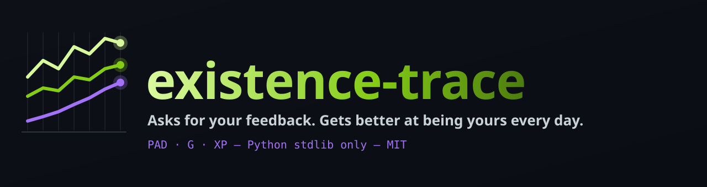
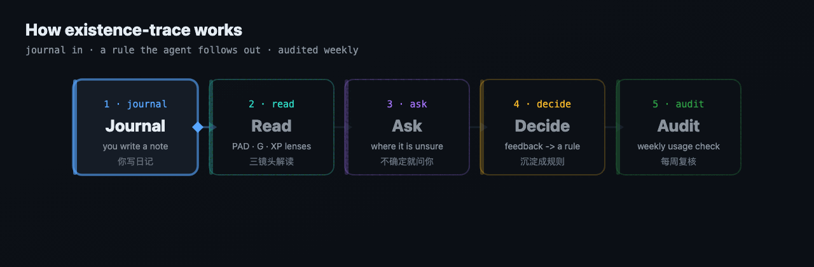

<p align="center"></p>

# existence-trace: AI agents that learn to read your journal

[](LICENSE)
[](https://www.python.org/)
[](#)
[](https://github.com/MaxonT/existence-trace/commits)
[](https://github.com/MaxonT/existence-trace/stargazers)

[中文](README.zh.md)

**A personal state system that asks you for feedback and gets better at being yours every day.**

You write a journal. An AI agent reads it through three lenses (PAD for emotion, G for security
and hope, XP for growth) and writes a daily report. Python 3 standard library only, MIT license.

## The self-improving preference loop

The report itself is not the main thing. The **preference container** (`etrace/container`) is.
The system notices where it is unsure, asks you, turns your answer into a rule, uses that rule in
the next real report, and checks every week that it actually did.

<p align="center"></p>

```
 notice doubt ──> ask you ──> your feedback ──> decide ──> change a rule
      ^                                                         │
      │                                                         v
 weekly audit <── usage receipt <── read back <── used in a real note
```

1. **Question.** The agent scans recent notes and stores a real doubt with evidence and two
   candidate readings (`question add`). It goes into today's note, and by email if you set that up.
2. **Feedback.** You write in the protected feedback zone of a note, or reply to the email.
   Start with `[Q-id]` to answer a question (`feedback ingest`).
3. **Decision.** The agent decides instead of waiting for exact numbers, writes down why, and
   changes rules (`decide`). In one scope the newest feedback wins; superseded rules leave the
   active set but stay in history. The next note shows a decision report you can overturn.
4. **Receipt.** When a decision really changes a report, the agent reads the file back and records
   a usage receipt (`usage add`). Reading a rule is not using it.
5. **Audit.** Every week `audit weekly` follows each chain (question → feedback → decision → rule
   → receipt) and fails if a decision was never applied.

`validate` checks the whole chain at any time and exits 1 on any problem.

## The 9 principles

The engine enforces these in code and tests; prompts tell the agent never to work around them.

1. **Verbatim.** Your words stay word for word. The AI writes only its own blocks; the original
   version can only grow by dated additions.
2. **An AI estimate never poses as a self-report.** Every number carries provenance
   (self_report / model_inference / gap_fill), a source and a confidence.
3. **Missing is not 0.** Empty stays empty or is marked pending. Filled gaps are low confidence
   and never train calibration.
4. **An event is booked once,** on the day it happened, with a unique event id.
5. **Freeze a prediction before judging it.** Value corrections need 10 training + 10 test days.
6. **Latest feedback wins** within one scope, by when you originally said it. Old feedback stays
   as evidence.
7. **Decide, report, invite feedback.** A reasonable decision with reasons now beats waiting; you
   can overrule it.
8. **Write, then read back. Reading is not using.** Only a verified change in a real output
   counts as applied.
9. **A self-rating is a reference, not an order.** Your raw value is kept and weighed with the
   evidence, and the AI says why it follows or departs from it.

## Quickstart

Requires Python 3.11+ (for `tomllib`). Nothing to install; run from a clone of this repository.

```sh
python3 -m etrace init --preset default --language en --dir ~/existence-trace-data
export ETRACE_CONFIG=~/existence-trace-data/trace.toml

python3 -m etrace validate          # {"ok": true, ...}
python3 -m etrace prompt daily --raw # the prompt an agent runs for the daily report
python3 -m etrace schedule --target claude-code --out ./my-schedule  # writes files, installs nothing
```

`init` creates `trace.toml`, `journal/` with today's note, `data/` with the preset's starting
rules, and `audits/`, `charts/`. Write in today's note, then let an agent run the tasks:

| Default time | Task | What it does |
|---|---|---|
| 09:00 | `calibrate` | scan recent notes, ask real questions, send the daily status |
| 12:30, 20:30 | `feedback` | read feedback, decide, change rules, report decisions |
| 19:30 | `daily` | PAD, XP, headline and narrative for today, with receipts |
| 20:30 | `g` | G estimate, frozen prediction, calibration |
| Sun 22:15 | `audit` | weekly audit of every feedback chain |

Every task commits the data root to its own local git repository (`checkpoint`). Times, language,
outreach (`note` or `note+email`) and optional Notion mirroring are set in `trace.toml`; see
[`examples/trace.toml`](examples/trace.toml) for every key.

**Presets.** `default` is general. `tiger-method` is one person's tuned dimensions, with no
personal events; its [README](presets/tiger-method/README.md) shows how to grow your own.

**Walk-through.** [`examples/persona`](examples/persona) is a fictional baker with three days of
notes and the agent's outputs; `tests/test_example.py` runs the whole loop on it.

## Layout

```
etrace/container/  preference container: questions, feedback, decisions, rules, usage, validate, audit
etrace/models/     pad.py  g.py  xp.py
etrace/outreach/   note.py  email.py (smtplib / imaplib)
etrace/adapters/   scheduler (codex / claude-code / cron), notion (optional output)
etrace/prompts/    zh/ and en/ task prompts sharing _principles.md
presets/           default, tiger-method
```

Tests: `python3 -m unittest discover -s tests -v`. `tests/test_privacy.py` fails the build if an
email address, a Notion-style id or a home directory path lands in the repository.

## Not a clinical tool

PAD, G and XP are personal reflection aids. They are **not clinical scales**, make no medical or
psychological judgement, and are no substitute for professional care. If you are struggling,
please reach out to a qualified professional or a local crisis line.

## Privacy

Your data lives only in your data directory, outside this repository. Email carries only the
context a question needs, never the full journal. Credentials are read from files you name in
`trace.toml` and never written into config, logs or prompts.
