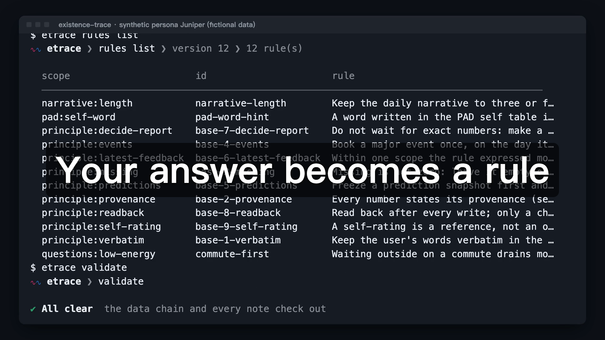
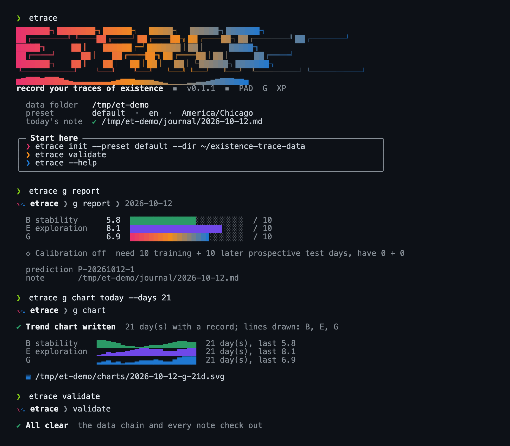

<p align="center"></p>

# existence-trace: AI agents that learn to read your journal

[](LICENSE)
[](https://www.python.org/)
[](#)
[](https://github.com/MaxonT/existence-trace/commits)
[](https://github.com/MaxonT/existence-trace/stargazers)

[中文](README.zh.md) · [Website](https://maxont.github.io/existence-trace/) · [For developers](https://maxont.github.io/existence-trace/developers.html) · [Install page](https://maxont.github.io/existence-trace/install/) · [Methodology](https://maxont.github.io/existence-trace/methodology.html)

**Record your traces of existence.**

You write a journal. An AI agent reads it through three lenses (PAD for emotion, G for stability
and exploration, XP for growth) and writes a daily report. The part that matters most is what happens
next: a **self-improving preference system** that asks you where it is unsure, turns your answer
into a rule, and proves every week that it actually used it. Python 3 standard library only, MIT.

> **Note.** Your words stay word for word; the AI only writes its own blocks. Every number says
> whether you said it or the AI inferred it. Your data lives in your own folder, not in this
> repository. PAD, G and XP are reflection aids, **not clinical scales**.

<p align="center"><a href="docs/assets/demo/demo.en.mp4"></a><br><a href="docs/assets/demo/demo.en.mp4">▶ Watch the 81-second demo</a></p>

⭐ If this is the kind of memory you want an AI to keep for you, a star helps others find it.

## Install

**Give it to your AI.** Paste this into Claude Code, Codex or any agent that can run shell commands:

```
Read https://maxont.github.io/existence-trace/install and install existence-trace for me.
```

It checks Python, installs the `etrace` command, asks you four questions (preset, language,
timezone, data folder), and creates your journal. It never edits your shell config without asking.

**Or in a terminal** (needs Python 3.11+; uses `uv`, `pipx` or `pip --user`):

```sh
curl -fsSL https://maxont.github.io/existence-trace/install.sh | bash
```

Add `--dry-run` to see what it would do first. Then:

```sh
etrace ai set                            # connect an AI (asks you; see "Connect an AI")
etrace import ~/Documents/diary --run    # bring in your old diary and let the AI read it
```

`--run` needs the AI, so connect it first (plain `etrace import PATH` works any time). Each command
creates your data folder if it is not there yet. No old diary? `etrace init`, then
`etrace note` opens today's page and `etrace run daily` reads it.

<p align="center"></p>

After your first successful command, the CLI asks once: `Star MaxonT/existence-trace on GitHub? [y/N]`. The default is no, it never asks again, and it stays silent in CI, pipes and scripts. A yes stars the repo through your own `gh` login (or prints the link if `gh` is missing). Set `NO_STAR_PROMPT=1` to skip the question.

## Bring in your diary

```sh
etrace import ~/Documents/diary          # a folder (any depth), files, or a Day One export
etrace import ~/Documents/diary --dry-run   # see what it would do first, change nothing
etrace import ~/Documents/diary --run    # then let the AI read the latest 7 days (--days N)
```

It reads `.md`, `.txt` and Day One `.json`. Each day's date comes from the file name
(`2026-03-04.md`, `20260304.txt`, `2026年3月4日.md`), the folder (`2026/03/04.txt`), a `date:` line, or a
date heading; a file with many dates (`## 2026-03-04`, `## 2026-03-05`...) is split into days. Files it
cannot place are listed, never guessed (`--date DAY` for one file, `--mtime` to use the file's own date).
Your words go word for word into each day's protected "Original version" block, which nothing can
rewrite; running it again changes nothing, and a changed file adds a dated addition. With no data folder
yet, `import` makes one (language guessed from your text, time zone from your machine).
To have the AI process a past day by hand: `etrace run daily --date 2026-03-04`.

## Connect an AI

`etrace run` uses any AI API you give it. Pick a service and answer two questions (key, model):

```sh
etrace ai set deepseek     # or: openai  anthropic  openrouter  ollama
etrace ai set custom --url https://my-proxy.example/v1    # any OpenAI-compatible address
etrace ai                  # show what is connected
etrace ai test             # one real call: reachable? does the model support tool calls?
etrace ai models           # the models your service offers
```

Run `etrace ai set` with no arguments for a menu. Anthropic uses its own format; every other
service speaks the OpenAI format. Pass `--model NAME` to skip the model question.

**Your key never touches your data folder.** It is looked up in this order: `$ETRACE_AI_KEY`,
then the file named by `[ai].key_file` (default `~/.config/etrace/ai.toml`, mode 600, which
`etrace ai set` writes for you), then the variable named by `[ai].key_env`. It is never accepted
as a command-line argument (shell history), never printed (only `…0123`), and never written
to `trace.toml`, which lives in a git repository. For a script: `echo $KEY | etrace ai set openai --key-stdin`.

`etrace run daily|g|feedback|calibrate|audit` hands the task to the model with two tools only:
run one `etrace` command, and read files in your data folder. There is no shell and no network
tool, and `init`, `schedule`, `ai` and `run` are blocked for the AI. It stops after 40 steps
(`--max-steps`). Prefer your own agent (Claude Code, Codex)? Skip this section:
`etrace prompt daily --raw` prints the same prompt.

## Commands

| Command | What it does |
|---|---|
| `etrace init` | create your data folder |
| `etrace ai [set\|test\|models]` | connect and check an AI API |
| `etrace run TASK` | let the AI do `daily`, `g`, `feedback`, `calibrate` or `audit` |
| `etrace import PATH...` | bring in your old diary (folder, files, Day One); `--run` lets the AI read it |
| `etrace note [-e]` | create today's note and show where it is; `-e` opens it |
| `etrace validate` | check the data chain and notes; exit 1 on any failure |
| `etrace pad` / `g` / `xp` | the three lenses: points, charts (`pad chart`, `g chart`), scores |
| `etrace question` / `feedback` / `decide` / `usage` / `outreach` | the preference loop |
| `etrace rules` / `audit` | read the rules; weekly audit |
| `etrace prompt TASK` | the prompt for your own agent |
| `etrace schedule` / `checkpoint` / `notion` | scheduler files, git commit, optional Notion mirror |

`etrace COMMAND --help` explains one command. Piped output is JSON; in a terminal you get the
pretty view (`--json` and `--pretty` switch it, `--no-color` or `NO_COLOR` turn colour off). The logo is drawn with plain full blocks only, so it looks the same in any terminal font.

**Other ways:** `pip install` the wheel from the [latest release](https://github.com/MaxonT/existence-trace/releases/latest),
or run the container from GitHub Packages: `docker run --rm -v ~/existence-trace-data:/data ghcr.io/maxont/existence-trace --help`.

## The self-improving preference loop

<p align="center"></p>

```
 notice doubt ──> ask you ──> your feedback ──> decide ──> change a rule
      ^                                                         │
      │                                                         v
 weekly audit <── usage receipt <── read back <── used in a real note
```

1. **Question.** The agent finds a real doubt in your notes, with evidence and two candidate readings.
2. **Feedback.** You answer in the protected zone of a note, or reply to the email.
3. **Decision.** It decides with reasons instead of waiting, and the newest feedback wins. You can overrule it.
4. **Receipt.** When a decision really changes a report, the agent reads the file back and records it. Reading a rule is not using it.
5. **Audit.** Every week `audit weekly` follows each chain and fails if a decision was never applied.

`etrace validate` checks the whole chain at any time and exits 1 on any problem.

## What a month looks like

<p align="center"><a href="https://maxont.github.io/existence-trace/methodology.html#pad"></a></p>

| Default time | Task | What it does |
|---|---|---|
| 09:00 | `calibrate` | scan recent notes, ask real questions, send the daily status |
| 12:30, 20:30 | `feedback` | read feedback, decide, change rules, report decisions |
| 19:30 | `daily` | PAD, XP, headline and narrative for today, with receipts |
| 20:30 | `g` | G estimate, frozen prediction, calibration |
| Sun 22:15 | `audit` | weekly audit of every feedback chain |

`etrace schedule --target codex|claude-code|cron --out DIR` writes the schedule files and installs
nothing. A fictional walk-through lives in [`examples/persona`](examples/persona); every key of
`trace.toml` is in [`examples/trace.toml`](examples/trace.toml).

## The 9 principles

The engine enforces these in code and tests; prompts tell the agent never to work around them.

1. **Verbatim.** Your words stay word for word.
2. **An AI estimate never poses as a self-report.**
3. **Missing is not 0.**
4. **An event is booked once.**
5. **Freeze a prediction before judging it.**
6. **Latest feedback wins** within one scope.
7. **Decide, report, invite feedback.**
8. **Write, then read back. Reading is not using.**
9. **A self-rating is a reference, not an order.**

The full text, the architecture and how to add a preset are on the
[developer page](https://maxont.github.io/existence-trace/developers.html). Tests:
`python3 -m unittest discover -s tests -v`; `tests/test_privacy.py` fails the build if an email, a
Notion-style id or a home directory path lands in the repository.

## Not a clinical tool

PAD, G and XP are personal reflection aids. They are **not clinical scales**, make no medical or
psychological judgement, and are no substitute for professional care. If you are struggling,
please reach out to a qualified professional or a local crisis line.

## Paid tier (preview)

A local pricing page with a Free plan and one paid plan, whose Subscribe button
opens Stripe Checkout. It is not deployed anywhere yet; it runs on your machine.

```bash
cp .env.example .env        # then fill in the three keys below
set -a; . ./.env; set +a
python3 pay/server.py       # open http://127.0.0.1:8787
```

| Key | Where to get it |
|---|---|
| `STRIPE_SECRET_KEY` | Stripe Dashboard → Developers → API keys (`sk_test_...` in test mode) |
| `STRIPE_PRICE_ID` | Create a product with a recurring price, copy its `price_...` id |
| `STRIPE_WEBHOOK_SECRET` | `stripe listen --forward-to 127.0.0.1:8787/webhook` prints a `whsec_...` |

- The price on the page is a placeholder: set `PAY_PRICE_LABEL` (for example `$9 / month`); the amount actually charged is the Stripe price behind `STRIPE_PRICE_ID`.
- Without keys the page still renders and Subscribe answers 503, so nothing is charged by accident.
- Real mode: switch the Dashboard to live, create the live price, and replace the three values with `sk_live_...`, the live `price_...` and the live webhook secret. Keys are read from the environment only; `.env` is git-ignored.

## Privacy

Your data lives only in your data directory, outside this repository. Email carries only the
context a question needs, never the full journal. Credentials are read from files you name in
`trace.toml` and never written into config, logs or prompts.
