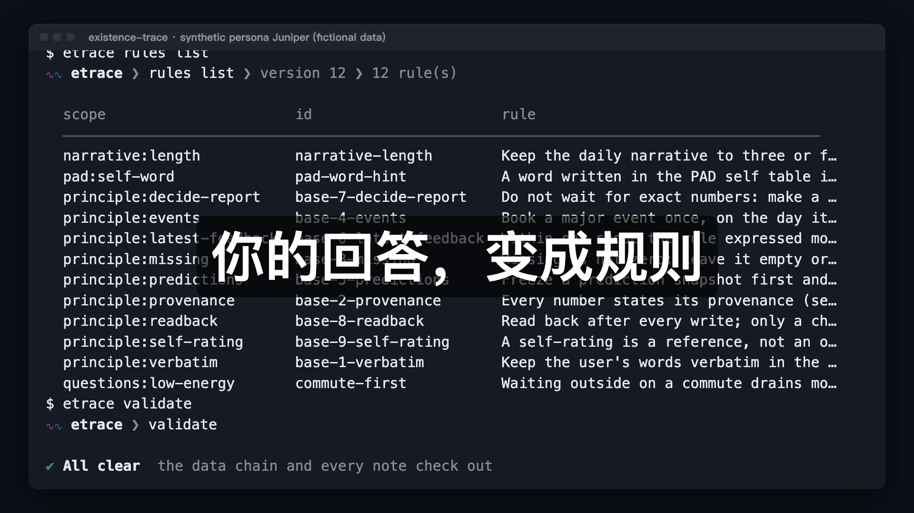

<p align="center"></p>

<h1 align="center">existence-trace（存在痕迹）</h1>

<p align="center"><b>你的 AI 读过你的每一行代码。<br>却从没读过你生活里的任何一天。</b></p>

<p align="center">一个每天读你日记的 AI：没把握的地方来问你，把你的回答变成规则，<br>而且必须<b>证明</b>它真的用上了。文件归你，模型随你选，MIT 协议。</p>

<p align="center">
<a href="LICENSE"></a>
<a href="https://www.python.org/"></a>

<a href="https://github.com/MaxonT/existence-trace/commits"></a>
<a href="https://github.com/MaxonT/existence-trace/stargazers"></a>
</p>

<p align="center"><a href="README.md">English</a> · <a href="https://maxont.github.io/existence-trace/">网站</a> · <a href="https://maxont.github.io/existence-trace/developers.html">开发者版</a> · <a href="https://maxont.github.io/existence-trace/install/">安装页</a> · <a href="https://maxont.github.io/existence-trace/methodology.html">方法论</a></p>

<p align="center"><a href="docs/assets/demo/demo.zh.mp4"></a><br><a href="docs/assets/demo/demo.zh.mp4">▶ 观看 81 秒演示</a></p>

## 半年以后，你还记得今天是什么感觉吗？

大概记不太清了。你的 AI 记得的只会更少。

你每周花好几个小时和 Claude、ChatGPT、Codex 打交道。它们记住了你的技术栈、你的仓库、你的命名习惯。
可它们对**你这个人**的了解（什么让你累、什么让你骄傲、你做了什么决定、为什么）要么存在厂商那份你没法逐条核对的记忆里，要么根本没存下来。

existence-trace 补上缺的那一半：一本你的 AI 真的会读的日记，文件在你自己手里。

- **你写。** 每天几行就够。也可以一条命令导入好几年的旧日记（`.md`、`.txt`、Day One）。
- **它读。** 每天用三个视角写一份日报：情绪（PAD）、稳定与探索（G）、成长（XP）。
- **它问。** 对你没把握的地方，它带着证据来问你一个真问题，而不是瞎猜。
- **它证明。** 你的回答变成规则。规则一旦改动了日报，它就记一张回执，写清改之前和改之后。每周审计，哪条规则从没被用上就判失败。

> 把你的偏好写进提示词，什么也证明不了。**读到不等于用上。**
> 在这里，每一句"我用了你的偏好"都附一张你能打开查看的回执。

它不取代 Claude 或 ChatGPT，而是给它们一些真正值得记住的东西。

## 聊天自带的记忆 vs. existence-trace

| | 聊天自带的记忆 | existence-trace |
|---|---|---|
| 存在哪里 | 厂商的账号里 | 你自己文件夹里的纯文本文件，用 git 管版本 |
| 谁决定记什么 | 主要是模型 | 你：它来问，你回答，回答变成带版本号的规则 |
| 你的原话 | 被概括 | 逐字保存在任何东西都改不了的区块里 |
| 用上了的证据 | 没有 | 一张写着改前改后的回执，外加会判失败的每周审计 |
| 用哪个 AI | 一家厂商 | 随你：Anthropic、OpenAI、DeepSeek、OpenRouter、Ollama，或你自己的代理 |
| 想离开 | 如果提供的话可以导出 | 不用导出，本来就是你的文件 |

## 适合谁

- 你天天泡在 Claude Code、Codex 或 ChatGPT 里，想要一个懂你这个人、而不只是懂你仓库的 AI。
- 你在写日记，或者一直想开始写。
- 你希望这份记忆归你自己：能读、能 grep、能备份、能删除的文件。

> **说明。** 你的原话逐字保存，AI 只写自己的区块。每个数值都标明是你说的还是 AI 推断的。
> 你的数据在你自己的文件夹里，不在本仓库。PAD、G、XP 是个人反思辅助，**不是临床量表**。

⭐ 如果你也想要一个必须证明自己懂你的 AI，点个 star 能帮更多人找到它。

## 安装

**交给你的 AI。** 把下面这句话贴给 Claude Code、Codex 或任何能运行 shell 命令的代理：

```
Read https://maxont.github.io/existence-trace/install and install existence-trace for me.
```

它会检查 Python、安装 `etrace` 命令、问你四个问题（预设、语言、时区、数据目录），然后创建你的日记。
没有你的同意，它不会改动你的 shell 配置。

**或者在终端里**（需要 Python 3.11+，会用 `uv`、`pipx` 或 `pip --user`）：

```sh
curl -fsSL https://maxont.github.io/existence-trace/install.sh | bash
```

加 `--dry-run` 可以先看它会做什么。然后：

```sh
etrace ai set                            # 接入 AI（会问你，见“接入 AI”）
etrace import ~/Documents/diary --run    # 导入你的旧日记，并让 AI 去读
```

`--run` 需要 AI，所以先接入（只导入、不加 `--run` 随时都行）。两条命令都会在数据目录还没有时顺手建好。
还没有旧日记？`etrace init`，然后 `etrace note` 打开今天这页，`etrace run daily` 让 AI 来读。

<p align="center"></p>

第一次成功运行命令后，CLI 会问一次：`Star MaxonT/existence-trace on GitHub? [y/N]`。默认是不点，以后不会再问；在 CI、管道和脚本里不会出现。回答 y 会用你自己的 `gh` 登录点 star（没装 `gh` 就只打印链接）。设置 `NO_STAR_PROMPT=1` 可以跳过这个问题。

## 导入你的日记

```sh
etrace import ~/Documents/diary             # 文件夹（任意层级）、文件或 Day One 导出
etrace import ~/Documents/diary --dry-run   # 先看它会做什么，不改任何东西
etrace import ~/Documents/diary --run       # 导入后让 AI 读最近 7 天（--days N）
```

支持 `.md`、`.txt` 和 Day One 的 `.json`。每天的日期取自文件名（`2026-03-04.md`、`20260304.txt`、
`2026年3月4日.md`）、文件夹（`2026/03/04.txt`）、`date:` 行或日期标题；一个文件里有多个日期标题
（`## 2026-03-04`、`## 2026-03-05`……）会按天拆开。认不出日期的文件会列出来，绝不瞎猜
（单个文件可加 `--date 日期`，或用 `--mtime` 取文件自己的日期）。你的原话逐字进入当天笔记受保护的
“原版本”区，任何人都改不了；重复导入不会有变化，文件改了会追加一段带日期的补写。
还没有数据目录时，`import` 会替你建（语言按你的文字判断，时区取自本机）。
想手动让 AI 处理某个过去的日子：`etrace run daily --date 2026-03-04`。

## 接入 AI

`etrace run` 可以用任何你给它的 AI API。选一个服务，回答两个问题（key、模型）：

```sh
etrace ai set deepseek     # 或：openai  anthropic  openrouter  ollama
etrace ai set custom --url https://my-proxy.example/v1    # 任何 OpenAI 兼容地址
etrace ai                  # 看现在接的是什么
etrace ai test             # 真实调用一次：连得上吗？模型支持工具调用吗？
etrace ai models           # 这个服务提供哪些模型
```

直接运行 `etrace ai set` 会给你一个菜单。Anthropic 用它自己的格式，其余服务都用 OpenAI 格式。
加 `--model 名字` 可以跳过选模型。

**你的 key 不会进入数据目录。** 查找顺序：`$ETRACE_AI_KEY`，然后是 `[ai].key_file` 指向的文件
（默认 `~/.config/etrace/ai.toml`，权限 600，由 `etrace ai set` 替你写好），最后是 `[ai].key_env`
指向的环境变量。key 不接受命令行参数（会留在 shell 历史里），不会被打印（只显示 `…0123`），
也不会写进 `trace.toml`（它在一个 git 仓库里）。写脚本时：`echo $KEY | etrace ai set openai --key-stdin`。

`etrace run daily|g|feedback|calibrate|audit` 把任务交给模型，它只有两个工具：运行一条 `etrace`
命令，以及读数据目录里的文件。没有 shell，也没有联网工具，`init`、`schedule`、`ai`、`run`
这几个命令对 AI 是屏蔽的。最多 40 步（`--max-steps`）。想用自己的代理（Claude Code、Codex）？
跳过这一节：`etrace prompt daily --raw` 会打印同一份 prompt。

## 命令一览

| 命令 | 作用 |
|---|---|
| `etrace init` | 创建数据目录 |
| `etrace ai [set\|test\|models]` | 接入并检查 AI API |
| `etrace run TASK` | 让 AI 做 `daily`、`g`、`feedback`、`calibrate` 或 `audit` |
| `etrace import PATH...` | 导入旧日记（文件夹、文件、Day One）；`--run` 让 AI 去读 |
| `etrace note [-e]` | 创建今天的笔记并告诉你在哪；`-e` 直接打开 |
| `etrace validate` | 检查数据链和笔记，有问题就以退出码 1 结束 |
| `etrace pad` / `g` / `xp` | 三个视角：记录点、图表（`pad chart`、`g chart`）、打分 |
| `etrace question` / `feedback` / `decide` / `usage` / `outreach` | 偏好闭环 |
| `etrace rules` / `audit` | 查看规则；每周审计 |
| `etrace prompt TASK` | 给你自己的代理用的 prompt |
| `etrace schedule` / `checkpoint` / `notion` | 调度文件、git 提交、可选的 Notion 镜像 |

`etrace 命令 --help` 查看单个命令的说明。管道输出是 JSON，在终端里是漂亮的视图
（`--json`、`--pretty` 切换，`--no-color` 或 `NO_COLOR` 关闭颜色）。logo 只用最普通的实心方块画成，在任何终端字体里看起来都一样。

**其他方式：** 从[最新 Release](https://github.com/MaxonT/existence-trace/releases/latest) 下载 wheel 用 `pip install` 安装，
或者用 GitHub Packages 上的容器：`docker run --rm -v ~/existence-trace-data:/data ghcr.io/maxont/existence-trace --help`。

## 会自我迭代的偏好闭环

<p align="center"></p>

```
 发现疑问 ──> 问你 ──> 你的反馈 ──> 做决定 ──> 改规则
    ^                                          │
    │                                          v
 每周审计 <── 使用回执 <── 读回核验 <── 用进真实笔记
```

1. **疑问**：代理在你的笔记里找到真实的疑问，附上证据和两个候选解释。
2. **反馈**：你在笔记受保护的反馈区回答，或直接回邮件。
3. **决定**：代理不干等，先做有理由的决定，最新反馈优先；你随时可以推翻。
4. **回执**：决定真的改变了日报，代理就读回文件核验并记录。读过规则不算用过。
5. **审计**：每周 `audit weekly` 沿着每条链检查，有决定从没落实就判失败。

`etrace validate` 随时检查整条链，有任何问题就以退出码 1 结束。

## 一个月是什么样

<p align="center"><a href="https://maxont.github.io/existence-trace/methodology.html#pad"></a></p>

| 默认时间 | 任务 | 做什么 |
|---|---|---|
| 09:00 | `calibrate` | 扫描最近的笔记、提出真实疑问、发当日状态 |
| 12:30、20:30 | `feedback` | 收反馈、做决定、改规则、发决定报告 |
| 19:30 | `daily` | 当天的 PAD、XP、主线和叙事，并写回执 |
| 20:30 | `g` | G 估值、冻结预测、校准 |
| 周日 22:15 | `audit` | 每周审计每条反馈链 |

`etrace schedule --target codex|claude-code|cron --out DIR` 只写调度文件，不安装任何东西。
虚构的完整示例在 [`examples/persona`](examples/persona)；`trace.toml` 的全部键见
[`examples/trace.toml`](examples/trace.toml)。

## 九条原则

引擎用代码和测试强制执行；prompt 要求代理永远不要绕过。

1. **原文保护**：你的原话逐字保存。
2. **AI 估计不冒充自述**。
3. **缺失不是 0**。
4. **事件只入账一次**。
5. **冻结预测再训练**。
6. **最新反馈优先**：同一适用范围内。
7. **先决定、再报告、邀请反馈**。
8. **写后核验，读过不算用过**。
9. **手填是参考，不是命令**。

完整说明、架构和如何新增预设见[开发者版](https://maxont.github.io/existence-trace/developers.html)。
测试：`python3 -m unittest discover -s tests -v`；只要仓库里出现邮箱、Notion 风格的 ID
或用户主目录路径，`tests/test_privacy.py` 就会失败。

## 不是临床工具

PAD、G、XP 是个人反思辅助，**不是临床量表**，不做任何医学或心理学判断，也不能替代专业帮助。
如果你正在经历困难，请联系合格的专业人士或当地危机热线。

## 隐私

你的数据只在你自己的数据目录里，不在本仓库。邮件只带回答问题所需的最少上下文，不复制日记全文。
凭据从 `trace.toml` 里指定的文件读取，不写进配置、日志或 prompt。
