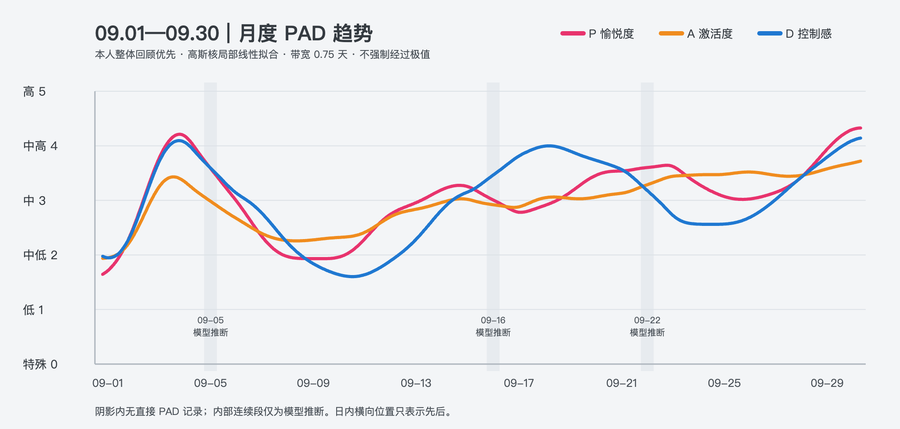

<p align="center"></p>

# existence-trace（存在痕迹）：会读懂你日记的 AI 代理

[](LICENSE)
[](https://www.python.org/)
[](#)
[](https://github.com/MaxonT/existence-trace/commits)
[](https://github.com/MaxonT/existence-trace/stargazers)

[English](README.md) · [网站](https://maxont.github.io/existence-trace/) · [开发者版](https://maxont.github.io/existence-trace/developers.html) · [安装页](https://maxont.github.io/existence-trace/install/) · [方法论](https://maxont.github.io/existence-trace/methodology.html)

**记录你的存在痕迹。**

你每天写日记。AI 代理用三个视角去理解你的一天：PAD（情绪）、G（稳定与探索）、XP（成长），
写成日报。但最重要的是接下来发生的事：一套**会自我迭代的偏好系统**。它在没把握的地方来问你，
把你的回答变成规则，并且每周证明自己真的用上了。只用 Python 3 标准库，MIT 协议。

> **说明。** 你的原话逐字保存，AI 只写自己的区块。每个数值都标明是你说的还是 AI 推断的。
> 你的数据在你自己的文件夹里，不在本仓库。PAD、G、XP 是个人反思辅助，**不是临床量表**。

⭐ 如果你也想让 AI 替你好好记住这些，点个 star 能帮更多人找到它。

## 安装

**交给你的 AI。** 把下面这句话贴给 Claude Code、Codex 或任何能运行 shell 命令的代理：

```
Read https://maxont.github.io/existence-trace/install and install existence-trace for me.
```

它会检查 Python、安装 `etrace` 命令、问你四个问题（预设、语言、时区、数据目录），然后创建你的日记。
没有你的同意，它不会改动你的 shell 配置。

**或者在终端里**（需要 Python 3.11+，会用 `uv`、`pipx` 或 `pip --user`）：

```sh
curl -fsSL https://maxont.github.io/existence-trace/install.sh | bash
```

加 `--dry-run` 可以先看它会做什么。然后：

```sh
etrace init --preset default --language zh --dir ~/existence-trace-data
export ETRACE_CONFIG=~/existence-trace-data/trace.toml
etrace validate            # All clear（加 --json 得到机器可读的输出）
etrace prompt daily --raw  # 代理跑日报时用的 prompt
```

<p align="center"></p>

**其他方式：** 从[最新 Release](https://github.com/MaxonT/existence-trace/releases/latest) 下载 wheel 用 `pip install` 安装，
或者用 GitHub Packages 上的容器：`docker run --rm -v ~/existence-trace-data:/data ghcr.io/maxont/existence-trace --help`。

## 会自我迭代的偏好闭环

<p align="center"></p>

```
 发现疑问 ──> 问你 ──> 你的反馈 ──> 做决定 ──> 改规则
    ^                                          │
    │                                          v
 每周审计 <── 使用回执 <── 读回核验 <── 用进真实笔记
```

1. **疑问**：代理在你的笔记里找到真实的疑问，附上证据和两个候选解释。
2. **反馈**：你在笔记受保护的反馈区回答，或直接回邮件。
3. **决定**：代理不干等，先做有理由的决定，最新反馈优先；你随时可以推翻。
4. **回执**：决定真的改变了日报，代理就读回文件核验并记录。读过规则不算用过。
5. **审计**：每周 `audit weekly` 沿着每条链检查，有决定从没落实就判失败。

`etrace validate` 随时检查整条链，有任何问题就以退出码 1 结束。

## 一个月是什么样

<p align="center"><a href="https://maxont.github.io/existence-trace/methodology.html#pad"></a></p>

| 默认时间 | 任务 | 做什么 |
|---|---|---|
| 09:00 | `calibrate` | 扫描最近的笔记、提出真实疑问、发当日状态 |
| 12:30、20:30 | `feedback` | 收反馈、做决定、改规则、发决定报告 |
| 19:30 | `daily` | 当天的 PAD、XP、主线和叙事，并写回执 |
| 20:30 | `g` | G 估值、冻结预测、校准 |
| 周日 22:15 | `audit` | 每周审计每条反馈链 |

`etrace schedule --target codex|claude-code|cron --out DIR` 只写调度文件，不安装任何东西。
虚构的完整示例在 [`examples/persona`](examples/persona)；`trace.toml` 的全部键见
[`examples/trace.toml`](examples/trace.toml)。

## 九条原则

引擎用代码和测试强制执行；prompt 要求代理永远不要绕过。

1. **原文保护**：你的原话逐字保存。
2. **AI 估计不冒充自述**。
3. **缺失不是 0**。
4. **事件只入账一次**。
5. **冻结预测再训练**。
6. **最新反馈优先**：同一适用范围内。
7. **先决定、再报告、邀请反馈**。
8. **写后核验，读过不算用过**。
9. **手填是参考，不是命令**。

完整说明、架构和如何新增预设见[开发者版](https://maxont.github.io/existence-trace/developers.html)。
测试：`python3 -m unittest discover -s tests -v`；只要仓库里出现邮箱、Notion 风格的 ID
或用户主目录路径，`tests/test_privacy.py` 就会失败。

## 不是临床工具

PAD、G、XP 是个人反思辅助，**不是临床量表**，不做任何医学或心理学判断，也不能替代专业帮助。
如果你正在经历困难，请联系合格的专业人士或当地危机热线。

## 隐私

你的数据只在你自己的数据目录里，不在本仓库。邮件只带回答问题所需的最少上下文，不复制日记全文。
凭据从 `trace.toml` 里指定的文件读取，不写进配置、日志或 prompt。
